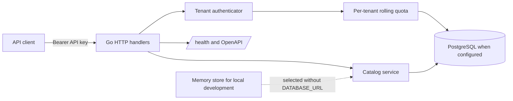
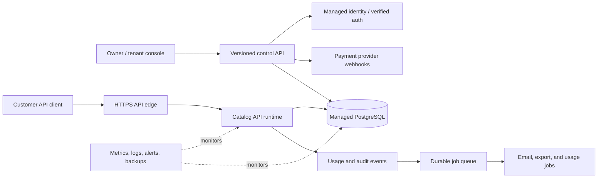

# RateCart architecture

## Current implementation

The current service is a Go API, not a SaaS control plane. API keys are manually configured in process environment; there is no customer account, billing, web UI, background queue, backup/restore process, or hosted operational proof. Local memory mode is not durable. Production mode requires PostgreSQL, but that alone does not make the service production-ready.

## Proposed boundary after validation

The proposed control plane is not implemented. Keep customer data out until authorization, migrations, backup/restore, deletion/export, key revocation, and operational ownership are reviewed.

## ADR-001: remain a prototype until a paid workflow is validated

- **Status:** Accepted, 2026-11-17.
- **Decision:** Keep the current local/API prototype as the reference implementation. Do not add payment or public self-serve account creation before buyer evidence and key/tenant lifecycle design.
- **Reason:** Hosted credentials, tenant isolation, predictable quotas, operations, privacy, and support obligations are not yet proven. A billing screen would create a false production signal.
- **Revisit when:** at least one qualified buyer provides a concrete workflow and agrees on a bounded paid pilot; key revocation and backup/restore are designed and tested.

## Security and operational constraints

- Keep API keys out of URLs, logs, client-side code, and support screenshots. Rotate/revoke per tenant before any hosted customer use.
- Use HTTPS, secret manager, least-privilege database credentials, bounded request bodies, tenant isolation tests, rate limits, and safe error responses.
- Add retention/deletion/export rules before real catalog data. Define backup retention, restore objectives, incident contact, and maintenance windows before a service commitment.
- Test both memory mode and PostgreSQL integration mode. Current PostgreSQL integration is skipped without a disposable `RATECART_TEST_DATABASE_URL`; race coverage is blocked on the current Windows toolchain (cgo/GCC unavailable).
